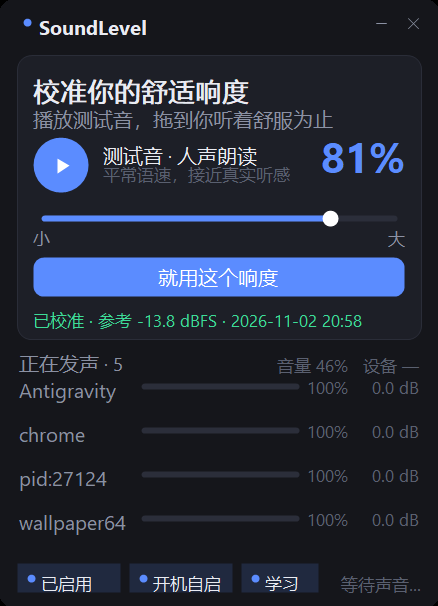

# SoundLevel — 让 Windows 上的声音响度一致

给自己用的小工具。盯着所有正在发声的 App，把**太响的压下来**，让它们听起来在一个水平线上。
不用装驱动、不用改系统设置、退出时自动恢复原音量。

## 它长这样



深色小窗口：上半部分是**校准区**（播一段人声，你拖滑块调到舒服，点一下就记住），
下半部分实时显示每个 App 的响度、增益和音量。

## 第一次用：校准

1. 点 **▶** —— 播放一段中文朗读（系统语音合成，平常语速）；
2. 一边听，一边拖下面的滑块 —— **拖到你觉得舒服为止**；
3. 点 **「就用这个响度」**；

程序会把「这个音量下听着舒服」换算成参考响度（dBFS），存进 `calibration.ini`，
以后所有 App 都按这个水平线来压。下次启动自动沿用。

> 想换素材：把任意 `speech.wav`（16bit PCM）放到程序目录，会优先用它，并自动归一化到 -12 dBFS。
> 没有 speech.wav 就用系统 TTS 现场合成。

## 下面的列表

```
chrome                     0.0 dB
████████████░░░░░░░░░░    100%↑
```

- 名字右边的 **dB** = 实际加了多少增益（负 = 正在压低）；
- 长条 = 当前响度（相对 -60 dBFS ~ 0 dBFS）；
- 右边的 **%** = 这个 App 在音量混合器里的实际滑块值；
- **↑** = 想往上抬，但已经顶到 100% 了（见下面的限制）。

左下角两个开关：

- **已启用**：整体暂停 / 恢复（暂停时会把所有 App 的原音量还回去）；
- **开机自启**：登录 Windows 后自动启动，**最小化到任务栏**，不抢焦点。

开机自启写的是当前用户的 `HKCU\Software\Microsoft\Windows\CurrentVersion\Run`，
不需要管理员权限，也不装服务；关掉开关就删除该启动项。
程序被挪到别的目录后再运行一次，启动项会自动修正成新路径。

## 它会学你

程序没法知道你耳朵里有多响，但它能看见你**拧音量**——这是唯一可靠的反馈信号。

- 你拧小系统音量 → 说明刚才那个 App 太吵 → 它的长期偏移往下调一点；
- 拧大则相反；
- 每次只走一半（避免过冲），单个 App 的偏移上限 ±6 dB；
- **只在「一个 App 明显在响」时才学**：几个同时响、或者分不清主次，就跳过不学，免得学歪；
- 学到的结果存在 `prefs.ini`，界面上「学习」开关可以随时关掉；删掉 `prefs.ini` 就全部忘光。

几个关键取舍：

- **主音量永远归你管**。程序不会去动它，更不会为了"补偿"你调小而偷偷把声音拉回去——那样音量键就废了；
- 学的是**每个 App 的相对偏好**，不是某个绝对响度。因为"舒不舒服"跟时间、环境、耳机还是外放都有关系，写死一个数是错的；
- 收敛是渐进的：同方向拧两三次之后，你基本就不用再拧了。

界面上能看到两个实时数字：**音量**（你的主音量）和 **设备**（音频设备当前的实际电平），后者就是"程序认为现在有多响"。

## ⚠️ 能力边界（实测，很重要）

**只能压，不能抬。**

Windows 给每个 App 的音量滑块范围是 0–100%，到 100% 就封顶。所以当一个 App 本来就很轻时，
程序算出来要 +10 dB，但滑块已经在 100%，实际一点没变（就是那个 `↑`）。

- ✅ 游戏/广告/网页突然很吵 → 压下来
- ✅ 两个 App 一响一轻 → 把响的压到轻的水平
- ❌ 视频人声太小想放大 → 做不到，得上 DSP（APO）

## 它不做什么

- 不处理 **WASAPI 独占模式 / ASIO** 的程序（部分游戏、专业音频软件）；
- 不动系统主音量，不联网，不写注册表，不留后台服务；
- 你手动拖某个 App 的滑块，程序会**接受你的改动**并当成新基准，不跟你抢。

## 配置

`config.ini`（改完重启生效）：

| 键 | 默认 | 说明 |
|---|---|---|
| `target` | -12 | 目标响度；校准后由 `calibration.ini` 覆盖 |
| `attack` | 200 | 变响时的反应速度（ms） |
| `release` | 2500 | 变安静后的恢复速度（ms） |
| `max_boost` / `max_cut` | 12 / 24 | 增益上下限（dB） |
| `gate` | -55 | 低于此电平不处理，保护底噪 |
| `safety` | 1 | 总线峰值保护 |
| `ignore` | — | 不处理的进程，逗号分隔 |

## 重新编译

不需要装 .NET SDK，用 Windows 自带的编译器：

```
build.cmd
```

产出 `SoundLevel.exe`（界面版）和 `selftest.exe`（命令行自测，`--tone` 会播测试音）。

源码：`src/Interop.cs`（WASAPI COM 声明）、`AudioEngine.cs`（会话枚举 + 控制环）、
`SpeechClip.cs`（TTS 生成 + 归一化）、`MainForm.cs`（界面）、`Controls.cs`（自绘控件）。

## 下一步（如果还想继续）

1. 学习你的主音量操作，自动收敛到你的习惯；
2. 写 APO / VST 做真正的 LUFS 归一 + 前瞻限幅，才能"抬"；
3. 托盘图标（现在自启后是缩在任务栏里）。
